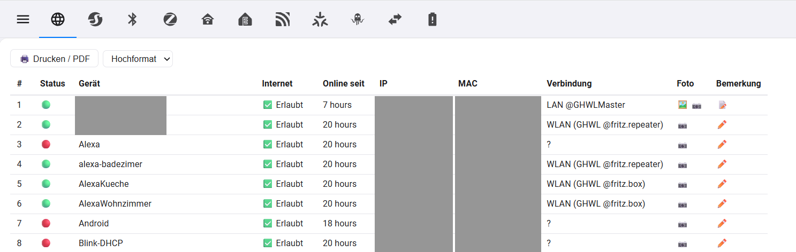
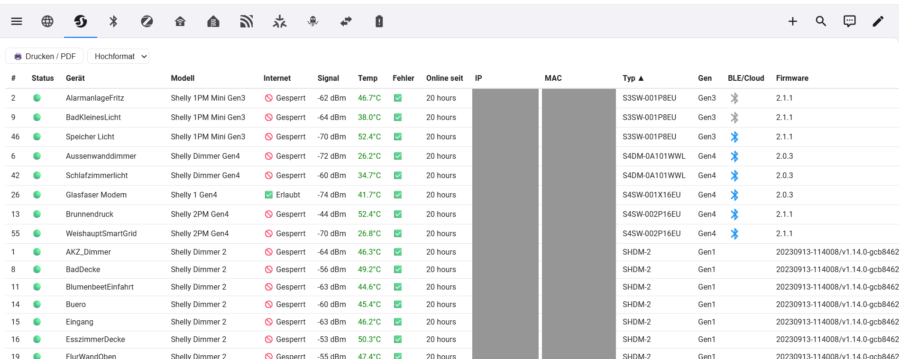
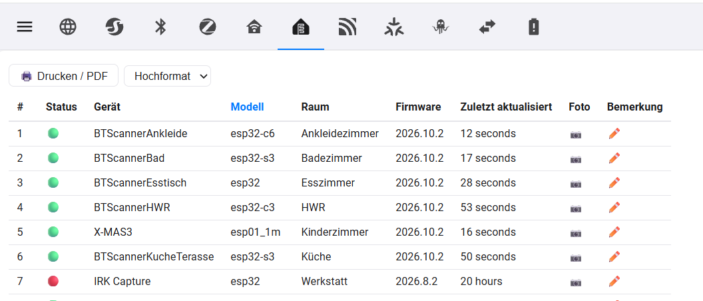
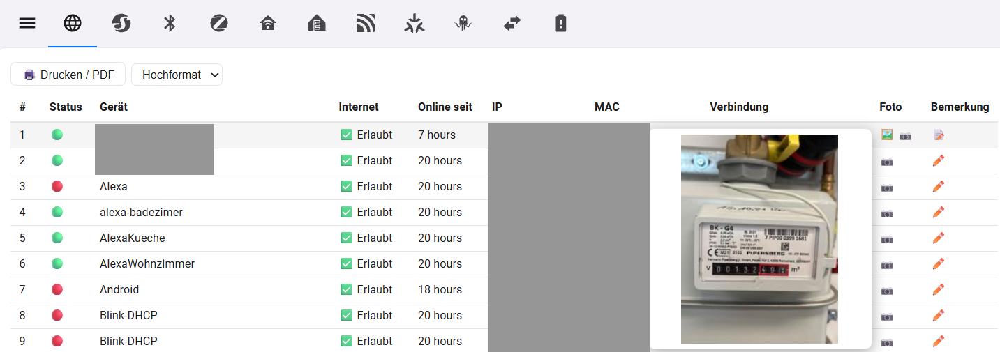

<p align="center"></p>

# Device Inventory for Home Assistant

Early Release, ungetestet !!!

Classified device tables for your whole smart home – one tab/card per device class
(Shelly, ESPHome, ZigBee, MQTT, Matter, WLED, Homematic, Z-Wave, Bluetooth, …) with

- 🟢/🔴 status LED (online = at least one live entity),
- sortable columns (name, model, area, manufacturer, firmware, battery, last seen),
- **several photos per device** (hover = thumbnail preview, click = gallery, upload/delete),
- **notes per device** (hover = text, click = editor),
- **print / PDF** (A4 portrait or landscape, with heading, photos and notes),
- `sensor.*_devices_offline` per class (+ one for all) with the names of the offline devices as attribute – ready for notifications and automations.

Photos and notes are stored server-side (`.storage/device_inventory`, `config/device_inventory/photos/`), so they are shared by all users and part of your backups.

> Status: **v0.1.0, early release.** Written against Home Assistant 2024.7+.

## Screenshots

The tables come from the author's dashboard that this integration grew out of (IP/MAC columns blacked out). The card in this repo renders the same kind of table.







Hovering the 🖼️ icon shows a thumbnail of the device's photo; a click opens the gallery.



## Install

**HACS** → ⋮ → *Custom repositories* → add this repository as type *Integration* → install → restart Home Assistant.
Manual: copy `custom_components/device_inventory` to your `config/custom_components/`.

Then *Settings → Devices & services → Add integration → Device Inventory* (one click, nothing to configure).
The card JavaScript is loaded automatically.

## Use

### Sidebar panel (ready to go)

After setup a **Device Inventory** entry appears in the sidebar. It is a complete dashboard with one tab per device class that exists in your system
(All, Shelly, ESPHome, ZigBee, Homematic, MQTT, Matter, WLED, Z-Wave, …), brand icons on the tabs and a red badge with the number of offline devices.
No Lovelace configuration is needed.

### Single card (optional)


Or put one table into any of your own dashboards (manual card, or a panel view with one card):

```yaml
type: custom:device-inventory-card
class: esphome        # all | shelly | esphome | mqtt | matter | wled | zigbee | zwave | homematic | tasmota | hue | tuya | bluetooth | other
title: ESPHome devices   # optional
hide: [battery, maker]   # optional: status, name, model, area, maker, fw, battery, seen, photos, note
```

Example automation: notify when `sensor.all_devices_offline` stays above 0 for 30 minutes.

## Notes

- Photo and note changes need an **admin** user. Everyone who can open the dashboard can view them.
- Photos are served without login (`/api/device_inventory/photo/<random 128 bit id>`) so `` tags work; the id is unguessable but anyone who knows a URL can open it. Do not photograph passwords.
- The device class comes from the integration of the device (see `const.py`, `CLASS_MAP`). A device bridged by two integrations appears in both tables. Add your own domains there (pull requests welcome).
- "Online" is a heuristic: a device is offline when *all* its entities are `unavailable`/`unknown`. Sleeping battery devices can look online for a long time.

## Deutsch (Kurzfassung)

Gerätetabellen je Klasse (Shelly, ESPHome, ZigBee, MQTT, Matter, WLED …) mit Status-LED, mehreren Fotos pro Gerät (Hover-Vorschau, Galerie), Bemerkungen, Druck/PDF (Hoch- oder Querformat) und Offline-Zählern als Sensoren. Installation über HACS (benutzerdefiniertes Repository) oder Ordner `custom_components/device_inventory` kopieren, neu starten, Integration hinzufügen, Karte `custom:device-inventory-card` mit `class: esphome` o. ä. einbinden.

## License

MIT
