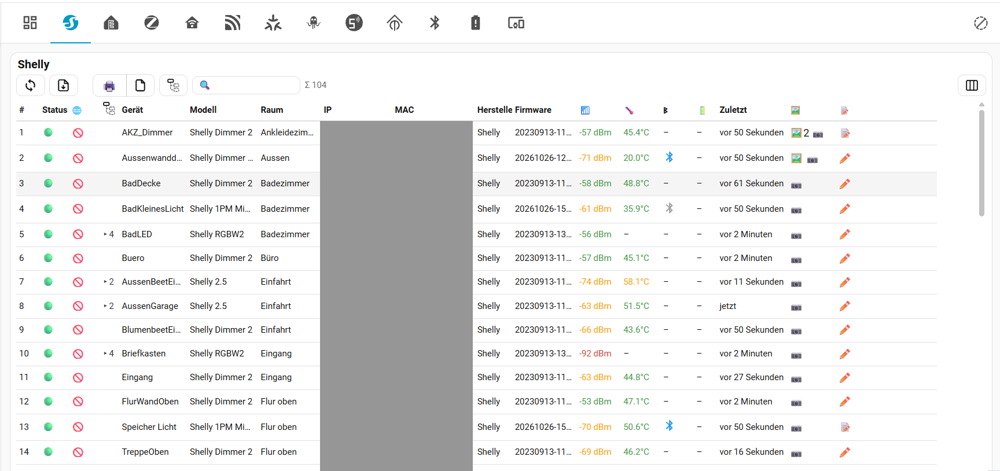
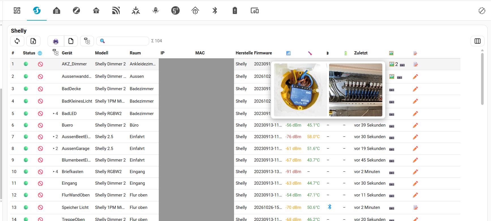
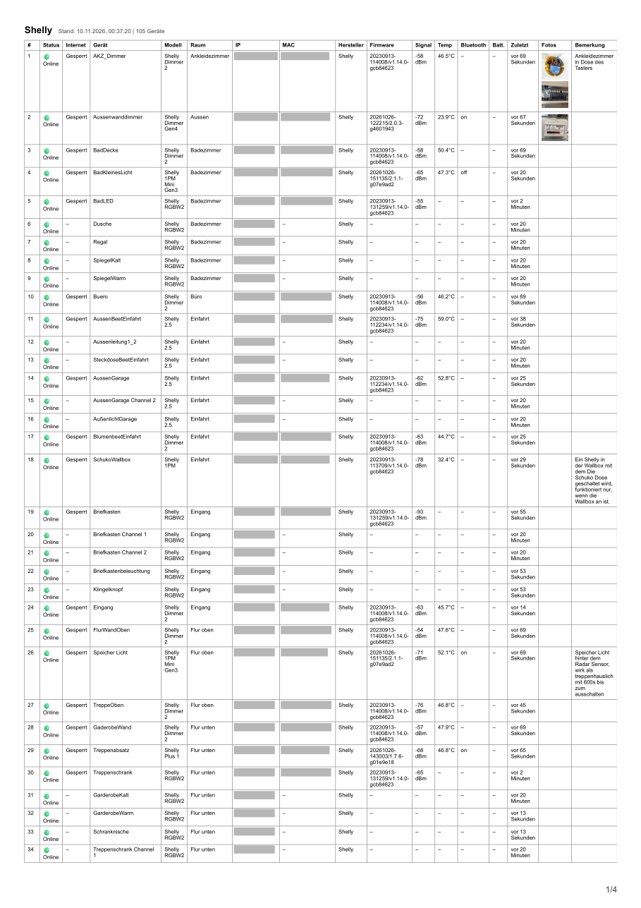

<p align="center"></p>

# Device Inventory for Home Assistant

One overview of **all devices in your smart home**, sorted by device class – with IP and MAC address, status, photos, notes and a printable documentation.
Made for installations with many devices where nobody remembers any more *which device sits where, under which address*, e.g. when an electrician has to take over or when you search for a fault.

- **One tab per device class:** All, Shelly, ESPHome, ZigBee, Homematic, MQTT, Matter, WLED, Sonoff, Tasmota, Z-Wave, Hue, Tuya, Bluetooth, Batteries, Other (only classes that exist in your system are shown, each with a red badge for offline devices).
- **Status LED** 🟢/🔴 per device (online = at least one live entity).
- **IP address as a link** to the web page of the device, **MAC address** (click = copy).
- **Several photos and a note per device** – where it is installed, which fuse, what is connected.
- **Sub-channels in a tree** – multi-channel devices (e.g. Shelly 2.5, RGBW2) show their channels folded under the main device.
- **Your own columns:** show / hide, order, width and even the **column names** – edited directly in the table, separately for the screen and for the printout (see *Columns: show, order, width*).
- **Print / PDF documentation** of exactly what you see – including photos and notes – for fault finding and for the electrician or installer (see *Printing / PDF – the documentation*).
- **Weak batteries are easy to find:** the *Batteries* tab lists the lowest batteries first; the photo (where is the sensor?) and the note (battery type, how to open it) show you the device and what to do, and the printed list can be taken along on the round.
- `sensor.*_devices_offline` per class (and one for all) with the names of the offline devices – ready for notifications.

Photos and notes are stored on the server (`.storage/device_inventory`, `config/device_inventory/photos/`): shared by all users and part of your backups.

> Status: **v1.x** – in daily use on the author's system (300+ devices, Home Assistant **2026.11**). The integration needs Home Assistant 2024.7 or newer, but it has so far **only been tested on 2026.11** – on older versions some details (e.g. IP / Bluetooth scanner data) may be missing; please report problems as an [issue](https://github.com/AlphaLima/ha-device-inventory/issues) with your Home Assistant version. Bug reports and pull requests are welcome.

## Screenshot

The *Shelly* tab of the sidebar panel (IP and MAC addresses blacked out): tabs with the device classes on top, toolbar (refresh, CSV export, print + page format, tree, search, column editor at the right), status LED, 🌐 internet switch, tree arrows (**▸4** = four sub-channels), signal, temperature, Bluetooth, battery, photos and notes.

<p align="center"></p>

Hovering the photo symbol shows the photos of the device right in the table (here: the Shelly in its flush-mounted box and the distribution cabinet) – the fastest way to answer *"where does this sit?"*:

<p align="center"></p>

## Example printout

[`docs/example-printout.pdf`](docs/example-printout.pdf) is a real printout (Shelly devices, A4 portrait, IP and MAC addresses blacked out): heading and page number on every page, status, signal, temperature, **photos** and **notes** per device, sub-channels (BadLED, AussenBeetEinfahrt …) listed below their main device.

<p align="center"><a href="docs/example-printout.pdf"></a></p>

## Install

**HACS / Marketplace** → *Custom repositories* → add this repository as type *Integration* → install → restart Home Assistant.
Manual: copy `custom_components/device_inventory` to your `config/custom_components/`.

Then *Settings → Devices & services → Add integration → Device Inventory* (one click, nothing to configure).
Reload the browser page (Ctrl+F5) after an update – the card JavaScript is loaded automatically.

## The sidebar panel

After setup a **Device Inventory** entry appears in the sidebar: a complete dashboard, no Lovelace configuration needed. Its symbol is the integration logo in one colour: the Bluetooth and Matter symbols above a list with three lines.

- The tabs along the top are the device classes. A **red badge** counts offline devices (on the *Batteries* tab: batteries at 20 % or below). The round switch at the right end of the tab bar controls the **problem view**: *off* (default, grey dashed circle) hides the red badges **and the missing (offline) devices in the lists**, so you see a clean list of what is working; *on* (red circle with a number) shows the badges and the missing devices. Tab tooltips and the device counter follow the switch. The choice is remembered in the browser. In your own dashboard card the same filter is `hide_offline: true`.
- Tab symbols: a tile grid for *All*, the brand logos of Shelly, ESPHome, ZigBee, Homematic, MQTT, Matter, WLED, Sonoff and Tasmota, the Bluetooth symbol for *Bluetooth* and a battery for *Batteries*. Hover a tab for its name and device count.
- The first tab shows all devices, the others only devices of that class. A device reached by two integrations (e.g. a Sonoff over ESPHome) appears in both.

### Toolbar (above every table)

| Symbol | Meaning |
|---|---|
| 🔄 (two circling arrows) | reload the list now (every tab switch reloads as well) |
| document-with-arrow symbol | **export the table as a CSV file** (see *CSV export*) |
| 🖨️ (next to the page symbol, set apart from the first two) | print / save as PDF |
| page symbol (▯ upright / ▭ lying page) | page format for printing; the symbol shows the current format, a click switches (remembered in the browser) |
| eye symbol (next to the page symbol) | **blur IP / MAC addresses** (also Bluetooth address, scanner IP, IRK) for screenshots; the printout then contains scrambled, blurred values instead of the real ones; remembered in the browser; the CSV export is not affected |
| columns symbol (three bars), **right end of the toolbar** | **edit the columns directly in the table** for the display *and* the printout (see *Columns: show, order, width*) |
| 🔍 field | search (see below) |
| tree symbol (shown only if sub-channels exist) | expand / collapse **all** sub-channels |
| Σ 105 | number of devices (while searching: hits / total) |

### Columns

Click a column heading to sort. Columns without any value in the current tab are hidden automatically (so the ZigBee tab has no temperature column, the Shelly tab has).

| Column | Content |
|---|---|
| `#` | running number |
| Status | 🟢 online / 🔴 offline |
| 🌐 Internet | FRITZ!Box internet access of the device: ✅ allowed, 🚫 blocked, ❔ unavailable, – none. **Click toggles** the switch, both directions ask for confirmation |
| tree symbol column | arrow with the number of sub-channels (see *Tree structure*); heading = expand/collapse all |
| Device | name (sub-channels are indented with └) |
| Model, Area | from the device registry |
| 📏 Distance, 🏠 Home | Bluetooth presence: estimated distance in m, home ✅ / away 🚫 |
| IP | link to `http://<IP>` (opens the web page of the device) |
| MAC | MAC address, click copies it |
| BLE MAC, Scanner, Scanner IP, IRK | Bluetooth presence (Private BLE Device and Bermuda): address, the scanner that sees the device (e.g. a Shelly or ESP proxy), its IP as link, the IRK (shortened, click copies the whole key) |
| Manufacturer, Firmware | from the device registry |
| 📶 Signal | WiFi signal in dBm (green ≥ −60, orange ≥ −75, red below) |
| 🌡️ Temp | device temperature (green up to 55 °C, orange up to 65 °C, red above) |
| ᛒ | Shelly Bluetooth scanner switch: blue = on, grey = off, **click toggles** |
| 🔋 | battery in % (red ≤ 20, orange ≤ 40) or *Low / OK* |
| Seen | time of the last update of any entity of the device |
| 🖼️ | photos (see below) |
| 📝 | note: the **note text is shown in the table** (cut with … when it does not fit, the whole text on hover; click = editor) – the width of the column sets how much is visible |

## Tree structure (sub-channels)

Multi-channel devices appear in Home Assistant as a main device with sub-devices (for example a Shelly 2.5 or RGBW2 with one device per channel, all with the same IP). Instead of cluttering the list, the channels are **folded under the main device**:

- A main device with channels shows an arrow and the number of channels in the narrow column in front of the name, e.g. **▸4**. All device names stay left-aligned, **only the channels are indented** and marked with └.
- **Click the arrow** to expand / collapse this device. **Click the tree symbol** (toolbar or heading of that column) to expand / collapse **all**. The tree symbol shows the state: *expanded* = full tree with three boxes in blue, *collapsed* = the top box solid and the two sub-boxes dashed grey. The choice is remembered in the browser.
- A device counts as a channel when Home Assistant lists it as *connected via* another device **of the same integration**; the main device must be in the list as well.
- **Search keeps the tree:** only matching channels are shown. If only a channel matches, its main device is shown expanded as context.
- Printing prints what is currently visible.

## Columns: show, order, width

No settings dialog – you edit the columns **directly in the table**:

1. Click the **columns symbol** (three bars) at the **right end of the toolbar**; the edit buttons (🖥️ Display, 🖨️ Printout, ↺ reset, ✓ done) appear next to it, also on the right. The table switches to *edit mode*: every column heading gets a small tool strip.
2. Choose **what you edit** with the switch next to it: **🖥️ Display** (what you see on screen) or **🖨️ Printout** (what is printed). Both have their own settings. So you cannot mix them up, the table shows one large, pale **watermark** in the middle (a blue **monitor** symbol for *Display* / an orange **printer** symbol for *Printout*) and a frame in the same colour while you edit.
3. In the heading of each column:
   - **checkbox** – show (display) / print (printout) this column. Switched-off columns stay visible but dimmed while you edit;
   - **◀ ▶** – move the column left or right;
   - **name field** below the tool strip – type your own **column name** (e.g. *Designation* instead of *Device*); empty = default name. Display and printout have separate names;
   - **drag the grey edge** at the right of the heading – set the width (double-click the edge = automatic again). On the *Printout* side the table shows the widths as they will be printed.
4. **📋** copies the whole layout (display and printout) as JSON to the clipboard, **📥** imports such a JSON – to take your layout to another browser or to share it. (Maintainers can store a layout as the built-in default in `DEFAULT_LAYOUT` at the top of `device-inventory-card.js`.)
5. **↺** resets the selected side to its defaults (after a **confirmation**, because all its settings – columns, order, widths, names – are lost), **✓** (or the columns symbol again) finishes the edit mode. Everything is saved immediately in the browser.

Defaults: *Display* shows everything that has data with automatic widths; *Printout* leaves out *Status* (online) and *Last seen* and uses a tuned set of column widths in mm (number 6, internet 12, name 22, model 19, room 16, IP 24, MAC 29, manufacturer 16, firmware 19, signal 14, temperature 10, battery 14, photos 18, note 63 – together about 280 mm, i.e. made for **landscape**; for portrait shrink or switch off columns). Columns without any value in the current tab stay hidden automatically, in both modes. In edit mode sorting by click on the heading is switched off.

## CSV export

The document symbol with a downward arrow next to 🖨️ saves the current table as a **CSV file** (`device-inventory-<class>-<date>.csv`) for Excel, LibreOffice or further processing:

- **Columns:** the columns of the *Display* layout (visible columns, their order and **your column names**); columns without data are left out like on screen. Values are plain text (no symbols): *Online / Offline*, *Allowed / Blocked*, battery in %, the note as text, the number of photos.
- **Rows:** what the **search filter** lists, in the current sorting – **all sub-channels included**, whether the tree is collapsed or not; an extra column *Main device* names the main device of each channel.
- **Format:** UTF-8 with BOM (Excel shows umlauts correctly); separator `;` when Home Assistant runs in German, otherwise `,`.

## Search

Type into the 🔍 field: the table filters while you type. Searched are name, model, room, IP, MAC, manufacturer, firmware, the note and the words *online* / *offline* (e.g. `.68`, `kitchen`, `offline`, `fuse 3`). **Esc** clears the field. The counter shows hits / total. **The search field is also the filter for the printout – on purpose:** whatever is listed is printed. Filter for a room (`kitchen`), a device class (open its tab), an address range (`192.168.188.6`) or `offline`, check the result on screen and print exactly that.

## Photos, notes, printing

**Photos** (column 🖼️)
- 📷 **add**: pick one or several images (JPG/PNG, resized to 1600 px in the browser).
- 🖼️ appears once a device has photos (a number = how many). **Hover** = thumbnail preview, **click** = gallery: click a photo to open it full size, **✖** on a photo deletes it, *Add photo(s)* adds more.
- Adding and deleting needs an admin user.

**Notes** (column 📝)
- ✏️ = no note yet, 📝 = note exists. The **text of the note is shown next to the symbol** (shortened with … if the column is too narrow – widen it in the column editor); hover shows the whole text.
- Click opens the editor: *Save* (or Ctrl+Enter), *Delete*, *Cancel* (or Esc). An empty text removes the note.

**Printing / PDF – the documentation**
- Choose the page format with the page symbol, then click 🖨️. In the browser's print dialog choose *Save as PDF* for a PDF.
- The printout is a **documentation of your installation**, not just a table: every row has the **photos** of the device (up to eight small thumbnails: where it is mounted, the wiring, the label) and its **note** (fuse, circuit, what is connected, remarks). That is what you hand to the **electrician or installer**, put in the folder in the technical room, or take along when you **search for a fault**: *which device, in which room, with which address, how does it look, what was noted*.
- **Choose the printed columns:** with the columns symbol next to 🖨️ (see *Columns: show, order, width*) – switch to **🖨️ Printout** and set which columns are printed, in which order, how wide and how they are **named** in the printout. By default *Status* (online) and *Last seen* are **not** printed. Columns that are hidden on screen because they are empty stay out of the printout as well.
- **What you see is what is printed:** current sorting, **the search filter**, the expanded / collapsed state of the tree and the visible columns. Open the tab of one device class, or filter for one room or address range, and print only that part – for example *"all Shelly devices in the basement"* for the electrician.
- Every page repeats the **heading** (category) – with the **symbol of the tab** (Shelly logo, battery, …) in front of it when you print from the sidebar panel – and the column titles; the page number is printed as **1/3** at the bottom right (Chrome / Edge 131 or newer). Date and device count are part of the heading.
- **Finding weak batteries:** open the *Batteries* tab (lowest first) and print it. Every row tells you which device it is, in which room, how it looks (photo) and what to do (note, e.g. *"CR2032, cover clips off at the bottom"*) – so the round with the battery tin is quick, also for someone who does not know the house.
- Tip: add the notes first (position, fuse number, circuit) and take 1–2 photos per device – then the printout answers most questions without a visit to the cabinet.
- On phones/tablets use the browser (Safari/Chrome); the Home Assistant app may not open the print dialog.

**Import from the old template dashboard:** notes (`netzwerk_bemerkungen`) and photos (`netzfoto_*`) of the author's earlier template-based dashboard are taken over once, automatically, when an admin opens the panel (only empty notes are filled). Harmless if you never had it.

## One table in your own dashboard (optional)

```yaml
type: custom:device-inventory-card
class: esphome        # all | shelly | esphome | mqtt | matter | wled | sonoff | tasmota | zigbee | zwave | homematic | hue | tuya | bluetooth | battery | other
title: My ESPHome devices   # optional, default is the category name
hide: [maker, fw]      # optional, columns to hide (keys below)
max_height: 70vh       # optional, height of the scroll area (default: window height - 170 px)
hide_offline: true     # optional, hide offline (missing) devices
max_cell: 170          # optional, maximum cell width in px before text is cut with "…"
```

Column keys for `hide`: `status internet kids name model area distance home ip mac bleaddr scanner scannerip irk maker fw signal temp ble battery seen photos note`.

Example automation: notify when `sensor.all_devices_offline` stays above 0 for 30 minutes (the attribute `offline_devices` lists the names).

## Notes

- The column settings (visibility, order, width, names; screen and printout), the page format, the tree state and the switch for missing devices are stored **in the browser** (local storage), not on the server: each browser / device has its own layout. Photos and notes, in contrast, are shared by all users.
- All texts are English by default and follow the Home Assistant language (English and German included; add a language by copying one block of the `T` table at the top of `device-inventory-card.js`).
- The **IP address** comes from the config entry (host) of single-device integrations such as Shelly, ESPHome or WLED, otherwise from an `…_ip` sensor, an `ip_address` attribute or the configuration URL of the device. It stays empty when none of these exist.
- Mirror entries of **network scanners** (FRITZ!Box "tracked device", generic Bluetooth entries) are hidden when a real device with the same MAC exists; its internet access switch is handed over to the real device. Devices without any entity are not listed.
- **Bluetooth phones, tablets and trackers** are often created twice, by *Private BLE Device* (with the IRK) and by *Bermuda* (with scanner and room), both under the same name. They are **merged into one row** that carries the data of both (IRK, scanner, distance, room, last seen). The row that already has photos or a note is kept; photos and notes of the other, hidden entry are not shown.
- A device belongs to the **Sonoff** tab when manufacturer, model or an entity id contains "sonoff"/"itead", whatever integration it uses.
- The device class comes from the integration of the device (see `const.py`, `CLASS_MAP`). Add your own domains there (pull requests welcome).
- "Online" is a heuristic: a device is offline when *all* its entities are `unavailable`/`unknown`. Sleeping battery devices can look online for a long time.
- Photo and note changes, the internet switch and the Bluetooth switch need an **admin** user for the write part; everyone who can open the dashboard can view photos and notes.
- Photos are served without login (`/api/device_inventory/photo/<random 128 bit id>`) so `` tags work; the id is unguessable but anyone who knows a URL can open it. Do not photograph passwords.
- The inventory is rebuilt every 2 minutes and on request (at most every 15 s). A warning is logged if building it ever takes longer than 0.5 s.

## Deutsch (Kurzfassung)

**Was es ist:** Eine Übersicht über alle Geräte im Haus, nach Klassen sortiert (Shelly, ESPHome, ZigBee, Homematic, MQTT, Matter, WLED, Sonoff, Tasmota, Bluetooth, Batterien …), mit Status-LED, IP-Adresse als Link zur Geräte-Webseite, MAC, Fotos, Bemerkungen und Papierdokumentation. Nach der Installation (HACS bzw. Marketplace als eigenes Repository, HA neu starten, Integration hinzufügen) erscheint „Device Inventory“ in der Seitenleiste. Der runde Schalter rechts in der Tab-Leiste steuert die **Problemansicht**: **aus** (Standard) blendet die **roten Zähler und die fehlenden (offline) Geräte in den Listen** aus, **an** zeigt beides. Auch der Zähler und die Tab-Tooltips folgen dem Schalter. Mit `custom:device-inventory-card` lässt sich eine Tabelle auch in ein eigenes Dashboard setzen.

**Werkzeugleiste:** 🔄 (zwei kreisende Pfeile) lädt neu · 🖨️ druckt (im Druckdialog „Als PDF speichern“) · das **Seitensymbol** zeigt das Druckformat (hochkant / quer) und schaltet beim Klick um · 🔍 filtert beim Tippen (Name, Modell, Raum, IP, MAC, Hersteller, Firmware, Bemerkung, online/offline; Esc leert) – **der Filter gilt bewusst auch für den Ausdruck** · das **Baumsymbol** klappt alle Unterkanäle auf bzw. zu · „Σ 5/105“ = Treffer/Gesamt.

**Spalten:** Status 🟢/🔴 · 🌐 Internet (FRITZ!Box-Zugang: ✅ erlaubt, 🚫 gesperrt; Klick schaltet, mit Rückfrage) · Pfeil-Spalte für Unterkanäle · Name · Modell · Raum · 📏 Entfernung und 🏠 Zuhause (Bluetooth-Präsenz) · IP (Link) · MAC (Klick kopiert) · BLE-MAC, Scanner, Scanner-IP, IRK · Hersteller · Firmware · 📶 WLAN-Signal · 🌡️ Temperatur · ᛒ Bluetooth-Schalter der Shellys (blau = an, Klick schaltet) · 🔋 Batterie · Zuletzt · 🖼️ Fotos · 📝 Bemerkung. Spalten ohne Werte werden automatisch ausgeblendet. Ein Klick auf die Überschrift sortiert. Spalten (Sichtbarkeit, Reihenfolge, Breite und **Namen**) lassen sich direkt in der Tabelle einstellen, getrennt für Anzeige und Druck (siehe unten); die Einstellungen liegen im Browser.

**Baumstruktur (Unterkanäle):** Mehrkanal-Geräte (z. B. Shelly 2.5, RGBW2) stehen mit ihren Kanälen **unter dem Hauptgerät**. Das Hauptgerät zeigt einen Pfeil mit der Zahl der Kanäle (**▸4**) in einer eigenen schmalen Spalte, deshalb stehen alle Gerätenamen linksbündig; nur die **Kanäle sind eingerückt** (└). Ein Klick auf den Pfeil klappt dieses Gerät auf/zu, das **Baumsymbol** (Werkzeugleiste oder Kopf der Pfeil-Spalte) klappt **alle** auf/zu. Das Symbol zeigt den Zustand: ausgeklappt = voller Baum mit drei Kästchen in Blau, eingeklappt = oberes Kästchen durchgezogen, die unteren zwei gestrichelt grau. Beim **Suchen** bleibt der Baum erhalten: nur passende Kanäle werden gezeigt; passt nur ein Kanal, wird sein Hauptgerät aufgeklappt mitgezeigt. Gedruckt wird, was gerade sichtbar ist.

**CSV-Export:** Das Dokument-Symbol mit Pfeil neben 🖨️ speichert die aktuelle Tabelle als CSV (Spalten und Namen der *Anzeige*, Zeilen nach Suchfilter und Sortierung, alle Unterkanäle mit Spalte „Hauptgerät“, UTF-8 mit BOM, Trennzeichen `;` bei deutschem HA).
**Fotos:** 📷 fügt ein oder mehrere Fotos hinzu (nur Admin). 🖼️ zeigt beim Überfahren eine Vorschau, ein Klick öffnet die Galerie; dort löscht das ✖ ein Foto.
**Bemerkungen:** ✏️ (noch keine) / 📝 (vorhanden) öffnet den Editor, Strg+Enter speichert.
**Spalten direkt in der Tabelle einstellen (Anzeige und Druck):** Das Spalten-Symbol (drei Balken) schaltet die Tabelle in den Bearbeitungsmodus. Mit dem Umschalter **🖥️ Anzeige / 🖨️ Druck** wählst du, was du bearbeitest (beides hat eigene Einstellungen). Damit man beides nicht verwechselt, zeigt die Tabelle beim Bearbeiten **einmal mittig ein großes, blasses Wasserzeichen** (blaues **Bildschirm**-Symbol für *Anzeige* / oranges **Drucker**-Symbol für *Druck*) und einen Rahmen in derselben Farbe. In jeder Spaltenüberschrift: **Häkchen** = Spalte anzeigen bzw. drucken (abgeschaltete bleiben beim Bearbeiten grau sichtbar), **◀ ▶** = verschieben, **Namensfeld** = eigener **Spaltenname** (leer = Standard, getrennt für Anzeige und Druck), **grauen Rand rechts ziehen** = Breite (Doppelklick = automatisch). **↺** setzt die gewählte Seite zurück (mit Rückfrage, weil alle ihre Einstellungen verloren gehen), **✓** beendet den Modus. Alles wird sofort im Browser gespeichert. Standard: Anzeige zeigt alles mit Daten, im Druck fehlen *Status* (Online) und *Zuletzt*. **Drucken = Dokumentation:** Format wählen, 🖨️ klicken. Der Ausdruck enthält je Gerät die **Fotos** (bis zu acht kleine Vorschaubilder) und die **Bemerkung** und dient als **Dokumentation zur Fehlersuche und für den Elektroinstallateur** (welches Gerät, in welchem Raum, mit welcher IP, wie sieht der Einbau aus, was wurde notiert). Gedruckt wird genau, was angezeigt wird: aktuelle Sortierung, **Suchfilter**, Auf-/Zuklappzustand des Baums und sichtbare Spalten, also z. B. nur „Shelly im Keller“. Überschrift und Spaltentitel auf jeder Seite, Seitenzahl „1/3“ unten rechts (Chrome/Edge 131+). **Schwache Batterien finden:** Tab „Batterien“ öffnen (niedrigste zuerst) und drucken – Foto (wo sitzt der Sensor?) und Bemerkung (Batterietyp, wie man ihn öffnet) machen den Austausch einfach, auch für Personen, die das Haus nicht kennen. Ein echter Beispielausdruck liegt in `docs/example-printout.pdf` (IP und MAC geschwärzt). Tipp: erst Bemerkungen (Standort, Sicherung, Stromkreis) und 1–2 Fotos pro Gerät hinterlegen, dann beantwortet der Ausdruck die meisten Fragen ohne Gang zum Schaltschrank.

## License

MIT

## Releasing (maintainers)

Work happens on the **`dev`** branch – pushes there create **no release** and notify nobody. A release is made **at most once a day**:

1. **Develop and test on `dev`.** Frontend-only changes: `python scripts/deploy.py` copies the integration into the Home Assistant config (Samba), then Ctrl+F5 in the browser. Backend (`*.py`) changes need a Home Assistant restart.
2. **Optional test release for testers:** `python scripts/release.py beta "what changed"` makes version `1.2.3b1` (tag `v1.2.3b1`) and `git push origin dev --follow-tags`; the workflow publishes it as a **GitHub pre-release**. Only people who enabled *Show beta versions* for this repository in HACS see it – everybody else stays on the stable version.
3. **Stable release (once a day):** merge `dev` into `main`, then `python scripts/release.py patch|minor|major|final "change 1" "change 2"` (bumps `manifest.json`, writes the changelog, commits, tags) and `git push origin main --follow-tags`. The workflow creates the release automatically – HACS and the Marketplace show that version. `final` turns the current beta `1.2.3bN` into the stable `1.2.3`.

Rule of thumb: backend changes are tested on a beta first, JavaScript-only fixes can go straight to the daily release.
